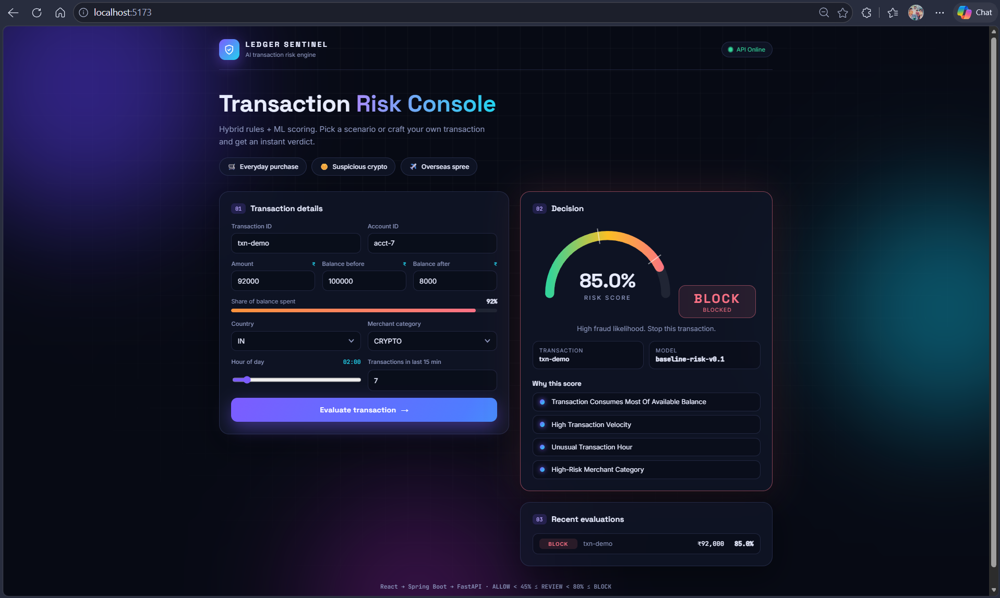
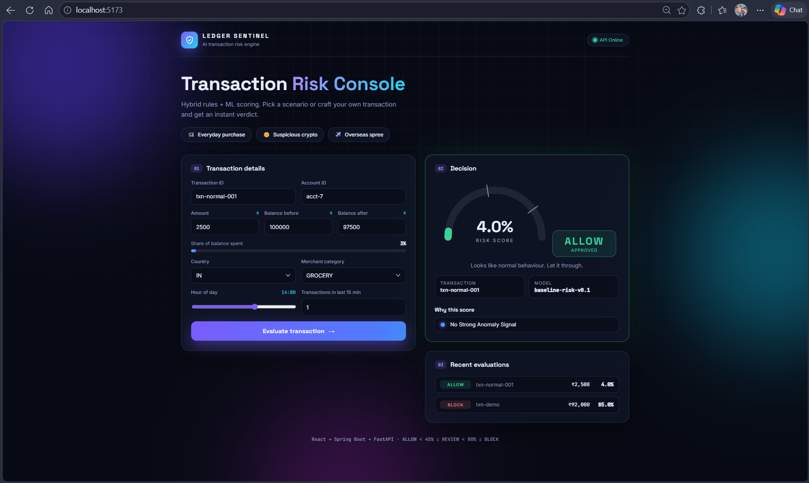
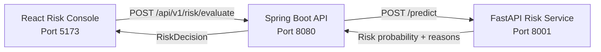

# Ledger Sentinel

**Real-time transaction risk scoring and decision engine built with React, Spring Boot, and FastAPI.**

Ledger Sentinel evaluates financial transactions in real time, calculates a risk probability, explains the signals behind the score, and converts the result into an actionable **ALLOW / REVIEW / BLOCK** decision.

The project is designed as a production-oriented foundation for a fraud and transaction-risk detection platform.

---

## Demo

### High-Risk Transaction — BLOCK

A suspicious transaction consuming most of the available balance, occurring at an unusual hour, with high transaction velocity and a high-risk merchant category.

**Risk Score: 85% → BLOCK**



### Normal Transaction — ALLOW

A normal grocery transaction with low balance impact, normal transaction timing, and low transaction velocity.

**Risk Score: 4% → ALLOW**



---

## Architecture



### Request Flow

```text
Transaction entered in React
          ↓
Spring Boot validates request
          ↓
RiskService prepares ML features
          ↓
FastAPI evaluates transaction
          ↓
Risk probability + explanations
          ↓
Spring Boot applies decision policy
          ↓
ALLOW / REVIEW / BLOCK
          ↓
React displays decision
```

---

## Why Ledger Sentinel?

Traditional transaction systems often rely heavily on fixed rules and may provide little context behind a decision.

Ledger Sentinel separates transaction processing from risk scoring and produces:

- Numerical risk probability
- Deterministic decision
- Explainable risk factors
- Model version
- Clear API contract between backend and scoring service

The scoring layer can later be replaced with a trained ML model without redesigning the frontend or core API.

---

## Risk Decision Policy

| Risk Score | Decision |
|---:|---|
| `< 45%` | **ALLOW** |
| `45% – < 80%` | **REVIEW** |
| `≥ 80%` | **BLOCK** |

Example:

```text
4%   → ALLOW
52%  → REVIEW
85%  → BLOCK
```

---

## Risk Signals

The current scoring engine evaluates multiple transaction-level signals.

### Balance Consumption

Measures how much of the available balance is being consumed.

```text
transaction amount / balance before
```

High balance consumption increases risk.

### Transaction Velocity

Evaluates transaction activity within a 15-minute window. High transaction frequency increases the risk score.

### Transaction Hour

Transactions occurring during unusual hours receive additional risk weighting.

### Merchant Category

Higher-risk categories such as:

- `CRYPTO`
- `GAMBLING`
- `HIGH_RISK`

increase the risk score.

### Cross-Border Activity

Transactions originating outside the baseline domestic country receive an additional risk signal.

---

## Explainability

Ledger Sentinel returns human-readable reasons along with the risk probability.

Example:

```json
{
  "probability": 0.85,
  "modelVersion": "baseline-risk-v0.1",
  "reasons": [
    "transaction consumes most of available balance",
    "high transaction velocity",
    "unusual transaction hour",
    "high-risk merchant category"
  ]
}
```

This allows the frontend to show **why** a transaction received its risk score instead of displaying only a number.

---

## Example Risk Evaluation

### High-Risk Transaction

```json
{
  "transactionId": "txn-demo",
  "accountId": "acct-7",
  "amount": 92000,
  "balanceBefore": 100000,
  "balanceAfter": 8000,
  "country": "IN",
  "merchantCategory": "CRYPTO",
  "hour": 2,
  "velocity15m": 7
}
```

Result:

```text
Risk:       85%
Decision:   BLOCK
Model:      baseline-risk-v0.1
```

### Normal Transaction

```json
{
  "transactionId": "txn-normal-001",
  "accountId": "acct-7",
  "amount": 2500,
  "balanceBefore": 100000,
  "balanceAfter": 97500,
  "country": "IN",
  "merchantCategory": "GROCERY",
  "hour": 14,
  "velocity15m": 1
}
```

Result:

```text
Risk:       4%
Decision:   ALLOW
Model:      baseline-risk-v0.1
```

---

## Tech Stack

### Frontend

- React
- Vite
- JavaScript
- Responsive dashboard UI

### Backend

- Java 21
- Spring Boot 3.5
- Spring Web
- Jakarta Bean Validation
- Spring Boot Actuator
- Springdoc OpenAPI

### Risk / ML Service

- Python 3.11+
- FastAPI
- Pydantic
- Uvicorn
- Risk-scoring engine

### Infrastructure

- Docker
- Docker Compose
- Maven
- Git

---

## Project Structure

```text
Ledger-Sentinel/
│
├── backend/
│   ├── src/
│   │   ├── main/
│   │   │   ├── java/
│   │   │   │   └── dev/zeeshan/ledgersentinel/
│   │   │   │       ├── api/
│   │   │   │       ├── config/
│   │   │   │       ├── domain/
│   │   │   │       └── service/
│   │   │   └── resources/
│   │   │       └── application.properties
│   │   └── test/
│   ├── Dockerfile
│   └── pom.xml
│
├── ml-service/
│   ├── app.py
│   ├── test_app.py
│   ├── requirements.txt
│   └── Dockerfile
│
├── frontend/
│   ├── src/
│   ├── index.html
│   ├── package.json
│   └── vite.config.mjs
│
├── docs/
│   └── screenshots/
│       ├── high-risk-block.png
│       └── normal-allow.png
│
├── docker-compose.yml
└── README.md
```

---

## API

### Evaluate Transaction

```http
POST /api/v1/risk/evaluate
Content-Type: application/json
```

Request:

```json
{
  "transactionId": "txn-1001",
  "accountId": "acct-7",
  "amount": 92000,
  "balanceBefore": 100000,
  "balanceAfter": 8000,
  "country": "IN",
  "merchantCategory": "CRYPTO",
  "hour": 2,
  "velocity15m": 7
}
```

Response:

```json
{
  "transactionId": "txn-1001",
  "probability": 0.85,
  "decision": "BLOCK",
  "modelVersion": "baseline-risk-v0.1",
  "reasons": [
    "transaction consumes most of available balance",
    "high transaction velocity",
    "unusual transaction hour",
    "high-risk merchant category"
  ]
}
```

### Health Endpoints

```http
GET /api/v1/risk/health
GET /health
```

---

## API Documentation

When the Spring Boot backend is running:

```text
http://localhost:8080/swagger-ui.html
```

Springdoc provides interactive OpenAPI documentation for the backend API.

---

## Running Locally

### Prerequisites

- Java 21+
- Maven 3.9+
- Python 3.11+
- Node.js 20+
- npm
- Docker Desktop — optional

### 1. Start ML Service

```powershell
cd D:\codes\Ledger-Sentinel\ml-service
.\.venv\Scripts\Activate.ps1
python -m uvicorn app:app --reload --port 8001
```

### 2. Start Backend

Open another terminal:

```powershell
cd D:\codes\Ledger-Sentinel\backend
mvn spring-boot:run
```

### 3. Start Frontend

Open another terminal:

```powershell
cd D:\codes\Ledger-Sentinel\frontend
npm install
npm run dev
```

Application:

```text
Frontend → http://localhost:5173
Backend  → http://localhost:8080
ML       → http://localhost:8001
```

---

## Docker Compose

Start the services with:

```powershell
cd D:\codes\Ledger-Sentinel
docker compose up --build
```

Services:

```text
ML Service → http://localhost:8001
Spring API → http://localhost:8080
```

---

## Testing

### ML Service

```powershell
cd ml-service
python -m pytest -q
```

### Backend

```powershell
cd backend
mvn test
```

### End-to-End API Test

```powershell
curl.exe -X POST "http://localhost:8080/api/v1/risk/evaluate" `
  -H "Content-Type: application/json" `
  --data-binary "@test.json"
```

---

## Engineering Decisions

### Separate Risk Service

The risk engine is isolated in FastAPI instead of being embedded inside Spring Boot.

This allows the scoring implementation to evolve independently and makes it easier to replace the baseline scorer with a trained model.

### Backend Orchestration

Spring Boot owns the application-facing API and decision policy.

The backend:

1. Validates transaction input
2. Sends features to the scoring service
3. Receives the prediction
4. Applies decision thresholds
5. Returns a consistent `RiskDecision`

### Explainable Output

The scoring service returns explicit risk reasons alongside the probability, making decisions easier to understand for analysts and downstream systems.

---

## Current Scope

The current version is a **deterministic ML-compatible baseline**, not a production-trained fraud model.

The scoring engine runs locally without requiring external paid APIs.

The architecture is designed so the baseline scorer can later be replaced by a trained model and real transaction infrastructure.

---

## Planned Production Hardening

### Data & Persistence

- PostgreSQL transaction storage
- Flyway database migrations
- Risk evaluation audit history
- Account and transaction entities
- Historical feature storage

### ML / Fraud Detection

- XGBoost / LightGBM model
- SHAP-based explainability
- Offline model evaluation
- Precision / Recall / F1 tracking
- Model versioning
- Feature engineering pipeline
- Rule + ML score fusion

### Distributed Systems

- Kafka transaction ingestion
- Event-driven risk evaluation
- Redis feature/risk caching
- Idempotency and duplicate-event handling

### Observability

- Prometheus metrics
- Structured logging
- Health and readiness checks
- Model latency tracking
- Risk-decision metrics

### Security

- JWT authentication
- Role-based analyst access
- API rate limiting
- Audit trails
- Secure configuration management

---

## Roadmap

```text
Current
  │
  ├── React Risk Console
  ├── Spring Boot API
  ├── FastAPI Risk Engine
  ├── Explainable risk signals
  └── ALLOW / REVIEW / BLOCK
       │
       ▼
Phase 2
  ├── PostgreSQL
  ├── Flyway
  ├── Redis
  └── Persistent audit history
       │
       ▼
Phase 3
  ├── XGBoost / LightGBM
  ├── SHAP
  ├── Model evaluation
  └── Model versioning
       │
       ▼
Phase 4
  ├── Kafka
  ├── Event-driven processing
  ├── Analyst feedback
  └── Retraining pipeline
       │
       ▼
Production
  ├── Authentication
  ├── Observability
  ├── Containerized deployment
  └── Production-grade risk platform
```

---

## Project Highlights

- Full-stack transaction risk evaluation pipeline
- Java/Spring Boot backend with clear service boundaries
- Dedicated Python/FastAPI scoring service
- Explainable risk decisions
- Real-time ALLOW / REVIEW / BLOCK classification
- REST integration between Java and Python
- Request validation and health endpoints
- Swagger/OpenAPI documentation
- Docker-ready architecture
- Designed for future ML model replacement and production hardening

---

## Author

**Mohammed Zeeshan**

B.Tech — Computer Science & Engineering (AI)

GitHub: **zeeshanverse**

LinkedIn: **Mohammed Zeeshan**